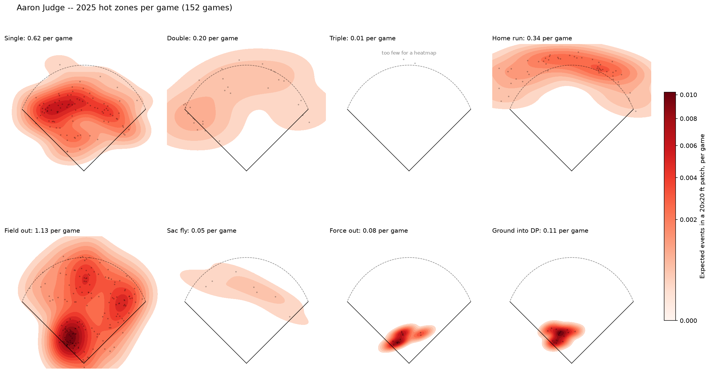

# sports_analytics_mlb

Rebuilding the kinds of views you see on Baseball Savant player pages (leaderboards, spray charts, zone heatmaps, percentile bars, comparisons) from public MLB data, in Python.

**Question:** Who are the best hitters in a given season, how do they get their results, and can I show it with clear charts built only from public data?

**Answer in one sentence:** (write this last, once the charts below exist)

## Status
- [x] Data pull with pybaseball (season batting stats, one hitter's Statcast pitches)
- [x] Shared setup module (`notebooks/library_imports.py`): imports, output folder, player search, season picker, data loaders
- [x] Interactive player search and season picker: every script asks which player and which season to chart
- [x] OPS leaders bar chart, MLB-qualified hitters, any season (`notebooks/ops_leaderboard.py`)
- [x] Spray chart colored by outcome (`notebooks/Spraychart_statcast.py`)
- [x] Outcome hot-zone heatmaps, where each result clusters on the field (`notebooks/heatmap_outcomes.py`)
- [x] Rate hot-zone heatmaps per game, per 100 PA, and per 100 AB (`notebooks/heatmap_rates.py`)
- [x] Pitch-location heatmap for one hitter (`notebooks/hitting_profile.py`)
- [x] Charts saved to `outputs/`
- [ ] Slash lines, best 5 per division, best per team
- [ ] Zone heatmaps with the strike zone drawn, percentile bars, comparison charts, distributions
- [ ] Record the pull date and data terms (see Data)
- [ ] Pushed to GitHub

## Data
| Source | Pulled with | Used for |
|---|---|---|
| Baseball-Reference batting stats by date range | `pybaseball.batting_stats_range(start, end)` | Leaderboards (G, PA, AB, OPS and the slash line) |
| Baseball Savant Statcast pitch-by-pitch | `pybaseball.statcast_batter(start, end, player_id)` | Spray charts, heatmaps, pitch locations |
| Chadwick Bureau player register | `pybaseball.chadwick_register()` | Player search (name to MLBAM id) |
| MLB Stats API season calendar | `statsapi.mlb.com/api/v1/seasons/{year}` | Exact regular-season start and end dates |

- Seasons: any season from 2015 (the first Statcast season) to the current one, chosen when a script runs.
- Pull date: (fill in)
- Terms of use: (link the sites' data-use pages here and credit them)
- Raw pulls are cached by pybaseball (`cache.enable()`) and are not committed. `data/raw/` and `data/baseball/raw/` are git-ignored.

## Decisions log
- **Qualified hitters only (Rule 9.22).** The leaderboard uses MLB's batting-title standard: 3.1 plate appearances per scheduled team game. That is 502 PA in a 162-game season and 186 in the 60-game 2020 season. OPS is OBP + SLG, and both use this standard, so OPS does too. For a season still in progress, the scheduled games so far are approximated by the most games any player has appeared in. This replaced an earlier flat 300-PA cutoff.
- **Regular season only.** Statcast pulls cover March 1 to November 30, then keep rows where `game_type == "R"`. That catches international openers such as the 2025 Tokyo Series (March 18–19) without a hand-kept table of opening days. Baseball-Reference date ranges have no such column and **include postseason games**. A March–November pull gave Aaron Judge 159 G and 710 PA for 2025, against his real 152 G and 679 PA. The leaderboard therefore uses exact regular-season dates from the MLB Stats API.
- **Player search.** The search ignores accents ("acuna" finds Acuña), accepts "first last", "last, first", or an MLBAM id, and falls back to the closest spelling for typos. Results are limited to players active in 2015 or later, since Statcast batted-ball data starts then.
- **Name fix.** Baseball-Reference names can come back with encoding errors (for example "Acuña"). `fix_name()` in `library_imports.py` repairs them.
- **Spray chart coordinates.** Statcast `hc_x` and `hc_y` are image pixels. `batted_balls()` converts them with `x = (hc_x - 125.42) * 2.5` and `y = (198.27 - hc_y) * 2.5`, which puts home plate at (0, 0) with the field in feet. The outfield wall is a stylized curve (330 ft down the lines, 400 ft to center), not each park's real dimensions.
- **Batted balls only.** Spray charts and heatmaps use rows where `type == "X"` and drop rows with no coordinates. A script stops with a message if a player has fewer than 50.
- **Hot zones are smoothed densities.** The heatmaps use a Gaussian kernel density estimate (`scipy.stats.gaussian_kde`). Outcomes with fewer than 5 events show the dots only, because a density built from 2 or 3 points is misleading.
- **Two heatmap scales, on purpose.** `heatmap_outcomes.py` scales each panel to its own peak, which shows *where* each outcome clusters. `heatmap_rates.py` puts every panel on one shared scale, which shows *how often* it happens there. A square-root color scale keeps rare outcomes visible.
- **Rate denominators.** Rate = density × event count × patch area ÷ denominator. Averaging per-game maps gives the same result, because the mean of per-game counts is total ÷ games.
  - **Games** = distinct `game_pk`.
  - **PAs** = distinct (`game_pk`, `at_bat_number`) whose last pitch has an `events` value. Baserunning rows such as caught stealing are excluded.
  - **ABs** = PAs minus walks, HBP, sacrifices, and catcher's interference.
  - Checked against Judge 2025: 152 G, 679 PA, 541 AB, matching his official line.

## Structure for the visuals
Every chart follows the same shape: one script, one data pull, one saved image. Built and planned charts:

| # | Chart | Data and key columns | Notes | Output file |
|---|---|---|---|---|
| 1 | Slash line table (AVG / OBP / SLG, OPS = OBP + SLG) | `batting_stats_range`: BA, OBP, SLG, OPS, AB, PA | Qualified hitters only | `table_slash-lines_<season>.png` |
| 2 | Top 10 hitters by OPS | same, sort by OPS, `head(10)` | **Done**, any season | `bar_ops-leaders_<season>.png` |
| 3 | Best 5 hitters per division | add a team-to-division lookup (`data/reference/mlb_divisions.csv`, 30 rows), then `groupby("Division")` | Traded players have combined or multiple team rows. Check before grouping | `bar_best5-per-division_<season>.png` |
| 4 | Best hitter per team (and chosen teams) | `groupby("Tm")` | Same traded-player check | `bar_best-per-team_<season>.png` |
| 5 | Pitching leaders: ERA, WHIP | `pybaseball.pitching_stats` with 1.0 IP per scheduled team game | Same Rule 9.22 standard | `bar_era-leaders_<season>.png` |
| 6 | Spray chart by outcome | `statcast_batter`: `hc_x`, `hc_y`, `events`, `type` | **Done.** Color and marker per outcome; pybaseball's built-in chart on a generic park as a second view | `spray_<player>_<season>.png` |
| 7 | Outcome hot zones | same as 6 | **Done.** One panel per outcome, each scaled to its own peak | `heat_<player>_<season>.png` |
| 8 | Rate hot zones | same as 6, plus games, PA and AB counts | **Done.** One shared scale; per game, per 100 PA, per 100 AB | `heat_<game\|pa\|ab>_<player>_<season>.png` |
| 9 | Pitch-location heatmap | `plate_x`, `plate_z` | **Done**, 2D bins | `heatmap_<player>_pitch-location_<season>.png` |
| 10 | Zone heatmap with strike zone | `plate_x`, `plate_z`, `sz_top`, `sz_bot`, plus one metric (swing rate, exit velocity) | Add the zone rectangle to 9 | `heatmap_<player>_swing-rate_<season>.png` |
| 11 | Pitcher heatmap and pitch usage % | `statcast_pitcher`: `pitch_type`, `plate_x`, `plate_z` | Usage % is a `value_counts(normalize=True)` | `heatmap_<pitcher>_location_<season>.png` |
| 12 | Percentile rankings (Savant-style bars) | exit velocity, barrel %, K %, BB %; `rank(pct=True) * 100` among qualified hitters | One row per metric, blue (low) to red (high) | `percentiles_<player>_<season>.png` |
| 13 | Comparison charts | two players' percentiles or rate heatmaps side by side | Rate heatmaps make players with different playing time comparable | `compare_<player>-vs-<player>_<season>.png` |
| 14 | Fastest players (sprint speed) | Statcast sprint speed leaderboard | | `bar_sprint-speed_<season>.png` |
| 15 | Distributions for each stat | `hist` / KDE of each metric among qualified hitters | Mark where a chosen player sits | `dist_<stat>_<season>.png` |

`notebooks/strike_zone.py` is a small demo of pybaseball's `plot_strike_zone`: it plots a chosen batter's pitches from a single day (April 23, 2023) of league-wide Statcast data.

**Metrics to cover:** AB, PA, AVG, OBP, SLG, OPS, wOBA, WAR, exit velocity, ERA, WHIP.

## Project layout
```
sports_analytics_mlb/
├── notebooks/
│   ├── library_imports.py      shared setup: imports, OUT folder, choose_player(), choose_season(),
│   │                           season_dates(), load_pitches(), batted_balls(), fix_name(), slug()
│   ├── ops_leaderboard.py      qualified OPS leaders for a season
│   ├── Spraychart_statcast.py  spray chart by outcome
│   ├── heatmap_outcomes.py     where each outcome clusters
│   ├── heatmap_rates.py        outcome rates per game / PA / AB
│   ├── hitting_profile.py      pitch locations a hitter saw
│   └── strike_zone.py          plot_strike_zone demo
├── src/              reserved for helpers once they outgrow library_imports.py
├── data/
│   ├── reference/    small hand-built lookups such as team-to-division (committed)
│   └── baseball/raw/ downloaded data (git-ignored)
├── outputs/          saved charts (committed, embedded below)
├── notes/            decisions.md
└── sql/              reserved for the SQL version of the leaderboards
```

## How a script starts
Every script in `notebooks/` begins the same way, so the player and season are chosen once at run time:
```python
from library_imports import *

PLAYER_ID, PLAYER_NAME = choose_player()   # search, then pick [1], [2], ...
START, END = choose_season()               # e.g. 2025
YEAR = START[:4]

df = load_pitches(PLAYER_ID, PLAYER_NAME, START, END)   # Statcast, regular season only
bb = batted_balls(df)                                   # balls in play, field coordinates in feet
```

## Saving charts
Each script saves to `outputs/` (the `OUT` folder from `library_imports.py`) before `plt.show()`:
```python
plt.savefig(OUT / f"spray_{slug(PLAYER_NAME)}_{YEAR}.png", dpi=150, bbox_inches="tight")
plt.show()
```
File names follow `chart-type_player_season.png`, lowercase with underscores. `slug()` turns "Ronald Acuña" into `ronald_acuna`.

## Findings
**Aaron Judge, 2025: rate hot zones per game.** Judge's field outs pile up on the left side of the infield (pulled ground balls), and his force outs and double plays come from the same spot. His home runs spread from left-center to right-center.



(Add 1 to 2 more charts from `outputs/`, each with one sentence saying what it shows.)

## Limitations
- Leaderboards use MLB's 3.1 PA per scheduled game standard. During a season, scheduled games so far are approximated from the most games any player has appeared in.
- Spray charts and heatmaps use field coordinates on a stylized park, not each stadium's real dimensions.
- The smoothed heatmaps spill slightly past the foul lines and behind home plate. That is the smoothing, not real batted balls.
- Season-total leaderboards for traded players need care (team labels).
- Statcast fields (exit velocity, location) can be missing for some pitches.
- Statcast pulls download March through November and filter afterward, so they include spring training and postseason rows before the filter. That is a few extra seconds per player.

## What I would do next
- Rebuild the leaderboards in SQL and R to show the same results three ways.
- Compare two hitters with the rate heatmaps, where per-PA scaling makes different playing time comparable.
- Add a Tableau or Power BI version of the leaderboard and percentile views.

## How to run
```
python -m venv .venv
.venv\Scripts\activate
pip install -r requirements.txt
python notebooks/ops_leaderboard.py
python notebooks/Spraychart_statcast.py
python notebooks/heatmap_rates.py judge     # optional: search term on the command line
```
Each script asks for a season, and every script except the leaderboard asks for a player. Core packages: pybaseball, pandas, numpy, matplotlib, scipy, requests.

## Credits
Data from Baseball-Reference.com, Baseball Savant (MLB Advanced Media), the Chadwick Bureau player register, and the MLB Stats API, accessed with the open-source `pybaseball` package.
